<!--
  Dveej Kotiya | Developer profile
  Original comic-book inspired red / blue visual identity.
-->

 

  

  

## 🕸️ ABOUT THE DEVELOPER

Hey! I'm **Dveej Kotiya** — an Electronics & Communication Engineering student exploring **Artificial Intelligence, Machine Learning, and software development**.

I enjoy learning by doing: taking an idea, breaking it into smaller problems, writing code, debugging it, and turning it into something useful.

- 🎓 Electronics & Communication Engineering student
- 🧠 Exploring AI, Machine Learning, and intelligent applications
- 💻 Interested in Python, app development, and web technologies
- 🔧 Learning through hands-on projects and experimentation
- 🎯 Working towards building technology that solves practical problems

> **My mindset:** Stay curious. Build consistently. Improve every version.

## 🚀 FEATURED PROJECTS

| Project | What it explores |
|---|---|
| 🚌 [SmartBusFaceRecognition](https://github.com/DveejKotiya/SmartBusFaceRecognition) | Face recognition for student identity and bus-pass verification |
| 🤖 [MyPersonalAI](https://github.com/DveejKotiya/MyPersonalAI) | A personal AI assistant project |
| 💧 [AquaServe](https://github.com/DveejKotiya/AquaServe-sem-6) | A water delivery platform with ordering and delivery-management features |

## 🧰 TECH STACK & TOOLS

**Languages & Web**

**Frameworks, Data & Development Tools**

## 📊 GITHUB IN THE SPOTLIGHT

 

 

## 🧭 CURRENT & NEXT MISSIONS

- [ ] Strengthen Python and core programming fundamentals
- [ ] Explore practical AI/ML implementations
- [ ] Build and document more useful projects
- [ ] Improve software design, testing, and problem-solving skills

## 🌐 CONNECT WITH ME

  

### 🕷️ A NEW DAY. A NEW IDEA. A NEW BUILD.

*Thanks for visiting my profile — let's keep learning, creating, and building.*

