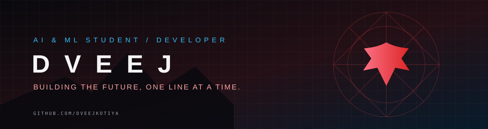

# 🕷️ D V E E J

### `AI & ML STUDENT` · `DEVELOPER` · `BUILDER`

**With great code comes great responsibility.**

---

## 🕸️ About Me

- 🎓 ECE student exploring **Artificial Intelligence & Machine Learning**.
- 💻 Interested in Python, Kotlin, web development, and practical software projects.
- 🔭 Building applications that solve real-world problems.
- 🌱 Currently strengthening my skills in software development and AI/ML.
- ⚡ I enjoy learning by building, testing, and improving.

## 🧪 Featured Projects

| Project | What it does | Stack |
|---|---|---|
| 💧 **AquaServe** | A digital water delivery and subscription management system. | Flutter, Kotlin, MongoDB |
| 🔐 **VaultGuard** | A Kotlin-based password manager concept. | Kotlin, Android |
| 📊 **E-commerce Sales Dashboard** | A dashboard project for exploring and presenting sales data. | Python / Data Analytics |

> Update each project name with its actual repository URL when the repository is public.

## 🧰 Tech Stack

  

## 📊 GitHub Activity

  
  

  

  

---

### 🕷️ “A little progress each day adds up to big results.”

*Thanks for visiting my corner of the multiverse.*

