<!-- Dveej Kotiya | Original comic-inspired developer profile -->

 

  

  

  

<a href="#about-me">ABOUT</a> &nbsp;•&nbsp;
<a href="#featured-builds">PROJECTS</a> &nbsp;•&nbsp;
<a href="#tech-toolkit">TECH STACK</a> &nbsp;•&nbsp;
<a href="#github-dashboard">GITHUB STATS</a> &nbsp;•&nbsp;
<a href="#connect">CONNECT</a>

## 🕸️ ABOUT ME

Hey, I'm **Dveej Kotiya** — an **Electronics & Communication Engineering student** interested in Artificial Intelligence, Machine Learning, and software development.

I like understanding how things work and turning what I learn into practical projects. My approach is simple: explore an idea, break it into smaller problems, build a solution, test it, and keep improving.

- 🎓 Electronics & Communication Engineering student
- 🧠 Exploring AI, Machine Learning, and computer vision
- 💻 Building with Python and modern development tools
- 🔍 Interested in intelligent systems and real-world problem solving
- 🌱 Always learning through projects, experimentation, and debugging

> **THE MINDSET:** Stay curious. Build with purpose. Make every version better.

## ⚡ WHAT I'M FOCUSED ON

<table>
<tr>
<td width="33%" align="center">

### 🧠 AI & ML

Exploring machine learning, face recognition, and intelligent applications.

</td>
<td width="33%" align="center">

### 💻 DEVELOPMENT

Strengthening programming fundamentals and building useful software.

</td>
<td width="33%" align="center">

### 🛠️ PROJECT BUILDING

Turning concepts into working prototypes and documenting the journey.

</td>
</tr>
</table>

## 🚀 FEATURED BUILDS

| Project | Overview | Core area |
|:--|:--|:--|
| 🚌 **[SmartBusFaceRecognition](https://github.com/DveejKotiya/SmartBusFaceRecognition)** | Face recognition, liveness checks, and automated student bus-pass validation | Python · PyTorch · OpenCV |
| 🤖 **[MyPersonalAI](https://github.com/DveejKotiya/MyPersonalAI)** | Personal AI assistant project | Python · AI |
| 💧 **[AquaServe](https://github.com/DveejKotiya/AquaServe-sem-6)** | Water-service platform project | JavaScript · Web |

*Explore the repositories for source code, implementation details, and updates.*

## 🧰 TECH TOOLKIT

**Languages & Web**

**Frameworks, Data & Developer Tools**

## 📊 GITHUB DASHBOARD

 

 

 

### 🐍 CONTRIBUTION SNAKE

<picture>
  <source media="(prefers-color-scheme: dark)" srcset="assets/github-contribution-grid-snake-dark.svg"/>
  <source media="(prefers-color-scheme: light)" srcset="assets/github-contribution-grid-snake.svg"/>
  
</picture>

## 🎯 NEXT MISSIONS

- [ ] Keep improving Python and problem-solving fundamentals
- [ ] Build and experiment with practical AI/ML applications
- [ ] Strengthen software development and testing skills
- [ ] Share more projects with clear documentation

## 🌐 CONNECT

  

### 🕷️ A NEW DAY. A NEW IDEA. A NEW BUILD.

*Thanks for stopping by. Let's keep learning, creating, and building.*

